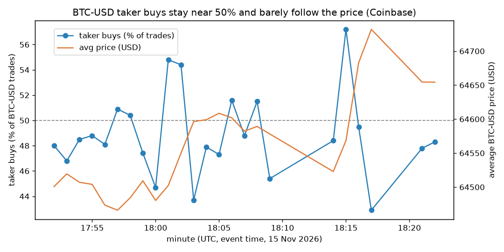

# Coinbase trades: BTC buy pressure per minute

**Author:** Mani Ferdosian
**DS 3022 Data Project 3, Fall 2026**

## Data source

Live trades from the Coinbase Exchange WebSocket (wss://ws-feed.exchange.coinbase.com), matches channel, for six products: BTC-USD, ETH-USD, SOL-USD, XRP-USD, DOGE-USD and ADA-USD. It's push, the producer subscribes once and Coinbase sends one match message per trade with trade_id, product_id, side, price, size and time. No account or key is needed. There's no replay so everything was collected live on 15 Nov 2026 between 17:52 and 18:22 UTC.

## How to run

From a fresh clone of ds3022-streaming:

```bash
python -m venv .venv
source .venv/bin/activate
pip install -r requirements.txt prefect matplotlib
docker compose up -d
docker exec -it redpanda-0 rpk topic create coinbase_trades -p 3 -r 3
cd project3
python producer.py       # terminal 1, Ctrl+C to stop
python lander.py         # terminal 2, Ctrl+C to stop after the last batch
python flow.py           # full data in data/raw
python flow.py data/sample      # runs without Kafka, on the committed sample
```

To see the runs in Prefect, run `prefect config set PREFECT_API_URL=http://127.0.0.1:4200/api` and `prefect server start` in another terminal first. Stop the cluster with `docker compose down` (never with -v).

## Architecture

```
Coinbase WebSocket
  -> producer.py  (key = product_id, envelope {"action": "live", "data": ...})
  -> Kafka topic coinbase_trades  (3 partitions, 3 replicas)
  -> lander.py  (1,000 records or 60 s per file, consumer group coinbase_trades_lander)
  -> data/raw/coinbase_*.parquet
  -> flow.py (Prefect flow coinbase-pipeline, DuckDB coinbase.duckdb)
       load_raw  -> raw_trades
       stage     -> stg_records
       entities  -> trades
       marts     -> mart_btc_pressure
       chart     -> charts/btc_buy_pressure.png
```

## Design decisions

1. **Key and partitions.** The key is product_id so all trades of one product stay in order in one partition, which is what I need to count buys and sells per minute for BTC-USD. The downside is skew since BTC-USD is 86% of all trades, partition 0 holds 82,521 of my 94,770 trades. A key like trade_id would spread better but then one product's trades would be split across partitions and lose their order.
2. **Batch size and time.** Files close at 1,000 records or 60 seconds. At about 61 trades a second the size rule closes almost every batch (94 of my 98 files have 1,000 rows), only the last batch after I stop the producer closes on time. That's around 220 files an hour.
3. **Offsets after the file.** If the lander crashes after writing a file but before storing offsets, it reads the same records again on restart and lands them a second time (card D1 gave me 1,000 copies). I accept that because a copy can be removed later in the flow but a lost record can't come back.
4. **Duplicates.** The same Kafka record is the same partition + offset, and `SELECT DISTINCT * EXCLUDE (landed_at)` in stage() removes it. The same thing is the same product_id + trade_id, removed in entities() with `QUALIFY row_number() OVER (PARTITION BY product_id, trade_id ORDER BY kafka_offset DESC) = 1`. Coinbase sends each trade only once so in my data entities() removed 0 rows, a trade never changes so any copy would be the same anyway.
5. **Windows and time.** I use event_time (the time field from Coinbase, cast to a UTC timestamp) and never landed_at, because a stopped lander makes gaps and spikes in landing time that didn't happen on the market. I use 1-minute windows since I only have about 30 minutes of data, 1-hour windows would give one or two points.
6. **Ten times the volume.** At around 600 trades a second partition 0 would get most of it because of BTC-USD, so one lander reading that partition would fall behind first. I'd also get about 2,200 small files an hour and the flow rereads all of them every run. I'd raise the batch size to 10,000, run more lander copies in the same consumer group and make the flow load only new files.

## Chaos round

| Card | Prediction | What I did | Numbers before → after | Explanation |
|---|---|---|---|---|
| D1 Crash between file and offsets | Raw goes up by the new messages plus the 1,000 crashed records, unique records only by the new ones | Stopped the lander, ran the producer for a few minutes, ran the lander with crash and then normally, counted | raw 71,255 -> 89,153; malformed 0 -> 0; unique records 71,255 -> 88,153; unique trades 71,254 -> 88,151 | Offsets get stored after the file so the crashed batch was read and landed twice (at-least-once). Unique records still match the topic total so the copies don't count and nothing was lost. |
| D2 Poison message | The lander keeps running and raw and malformed both go up by 1 | Sent "this is not JSON" to the topic with rpk, waited for the next batch, counted | raw 89,153 -> 89,154; malformed 0 -> 1; unique records 88,153 -> 88,153; unique trades 88,151 -> 88,151 | `to_row()` caught the bad JSON and landed it as malformed, so the lander didn't crash. If it had crashed it would hit the same message on every restart and block the partition. |
| D3 Broker down | The producer logs some errors but keeps going and nothing gets lost | Stopped redpanda-1 for about a minute and a half while the producer and lander ran, started it again, stopped the producer, counted | raw 89,154 -> 95,792; malformed 1 -> 1; unique records 88,153 -> 94,791; unique trades 88,151 -> 94,788 | With replication factor 3 the other two brokers took over as leaders and kept taking writes. Raw and unique records both went up by 6,638 so nothing was lost or duplicated. |

## The four numbers

From the flow log on the full data (screenshot in `docs/`):

| Number | Full data | Sample (`data/sample`) |
|---|---:|---:|
| Raw records landed | 95,792 | 5,000 |
| Malformed (kept in raw) | 1 | 0 |
| Unique Kafka records | 94,770 | 4,998 |
| Unique trades (`product_id` + `trade_id`) | 94,770 | 4,998 |

Unique Kafka records is a bit lower than four_numbers.py gave in the chaos round (94,791) because stage() also drops the subscriptions and last_match messages, which aren't new trades.

## Challenges / Obstacles

Coinbase has no replay so I could only collect live, and the first messages after connecting are a subscriptions reply and one last_match per product, which aren't new trades. The producer sends them anyway (the subscriptions one has no product_id so it goes without a key) and stage() filters them out with msg_type = 'match'. The side field was confusing at first since it's the maker side, so side = 'sell' actually means the taker bought. BTC-USD also makes up 86% of trades so partition 0 is much bigger than the other two. For the tools I used rpk and the Redpanda Console to check the topic, four_numbers.py to count during the chaos round, and DuckDB plus Prefect for the flow.

## Analysis

My question was whether buy pressure on BTC-USD, the share of trades in each minute where the taker was a buyer, moves with the price. Across 24 one-minute windows (81,643 BTC-USD trades) the taker buy share stayed between 42.9% and 57.2% with an average of 48.9%, so sellers were slightly more aggressive most minutes, and the correlation with the average price was weak (-0.23). What surprised me is that the biggest buy minute (57.2% at 18:15 UTC) came right before the biggest price jump, but by 18:17 when the price peaked at 64,732 USD the buy share had dropped to its lowest at 42.9%, so the buying seemed to come before the move and not with it. The main limitation is that it's only about 30 minutes of one evening with gaps at 18:10 to 18:13 and 18:18 to 18:20 when my producer was stopped for the chaos cards, so I can't say anything about other hours or days.

## Plot / Visualization



## Reflection

Before this class I thought of streaming as just reading data as it comes in, I didn't really think about what happens when something breaks in the middle. The chaos round changed that the most. Seeing the lander crash after writing a file and then land the same 1,000 records again made at-least-once make sense, and it showed me why the flow has to remove copies instead of hoping they never happen. I also learned that the key decides how the data spreads, my product_id key put 86% of the trades on one partition which I didn't expect when I picked it. Stopping a broker and watching the producer keep going showed me what replication factor 3 actually does. If I started again I'd collect for longer and at different times of day so my analysis covers more than half an hour, and I'd pick a key or add products so the partitions are more even.

## Acknowledgements

The producer, lander and flow start from the class scripts quakes_producer.py, quakes_lander.py and quakes_flow.py, and the SCHEMA, to_row(), stage(), entities() and four_numbers.py code comes from the Session 2 and 3 worksheets. The WebSocket subscribe message follows probe.py from the kit. I used Claude (Claude Code) as an AI assistant to help adapt the scripts, run the chaos cards and explain code and and files to write this README. I checked the results by running the flow twice and comparing the four numbers, checking them against the topic totals from rpk, and reading through the code and text myself.
